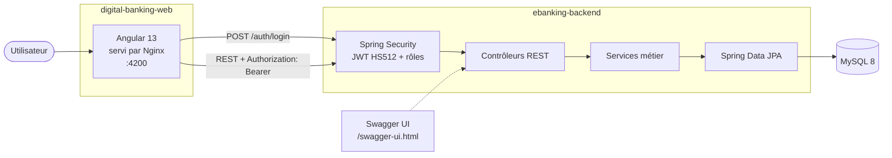

# E-Banking Backend — API REST Spring Boot sécurisée par JWT

[](https://github.com/erryhany/ebanking-backend/actions/workflows/ci.yml)


Backend de l'application **Digital Banking** : gestion des clients, des comptes courants et épargne, et des opérations (débit, crédit, virement) avec historique paginé. L'API est stateless, sécurisée par **JWT** (Spring Security OAuth2 Resource Server) avec des rôles **USER** et **ADMIN**.

> 🖥️ **Frontend Angular** : [erryhany/digital-banking-web](https://github.com/erryhany/digital-banking-web)
> Les deux dépôts forment une application full-stack, lancée en une commande avec Docker Compose (voir plus bas).

## Architecture



## Fonctionnalités

- **Clients** : CRUD et recherche par mot-clé
- **Comptes bancaires** : comptes courants (avec découvert) et comptes épargne (avec taux d'intérêt), modélisés par héritage JPA (`SINGLE_TABLE`)
- **Opérations** : débit, crédit et virement entre comptes, avec contrôle du solde
- **Historique** des opérations d'un compte, paginé
- **Authentification JWT** : jeton signé en HS512, valable 10 minutes
- **Autorisations par rôle** avec `@PreAuthorize` : lecture pour USER, écriture pour ADMIN
- **Documentation** de l'API via Swagger UI (springdoc-openapi)
- **Tests** unitaires JUnit 5 + Mockito sur les opérations bancaires
- **Intégration continue** : compilation, tests et build Docker à chaque push (GitHub Actions)

## Stack technique

| Couche | Technologies |
|---|---|
| Langage | Java 17 |
| Framework | Spring Boot 3.4 (Web, Data JPA, Security, OAuth2 Resource Server) |
| Sécurité | JWT (Nimbus JOSE), BCrypt |
| Base de données | MySQL 8 (H2 pour les tests) |
| Documentation | springdoc-openapi (Swagger UI) |
| Tests | JUnit 5, Mockito, AssertJ |
| Outils | Maven, Lombok, Docker, GitHub Actions |

## 🚀 Démarrage rapide avec Docker

Prérequis : Docker et Docker Compose.

```bash
git clone https://github.com/erryhany/ebanking-backend.git
cd ebanking-backend
cp .env.example .env        # puis renseigner JWT_SECRET et DB_PASSWORD
docker compose up -d --build
```

Cette commande lance **MySQL**, le **backend** et le **frontend** (construit directement depuis son dépôt GitHub).

| Ressource | URL |
|---|---|
| Application web | http://localhost:4200 |
| API | http://localhost:8085 |
| **Swagger UI** | **http://localhost:8085/swagger-ui.html** |

Pour générer un `JWT_SECRET` (au moins 64 caractères) :

```bash
openssl rand -base64 64 | tr -d '\n'
```

Arrêt : `docker compose down` (ajouter `-v` pour supprimer aussi les données MySQL).

## Lancer le backend sans Docker

Prérequis : Java 17 et un serveur MySQL local (la base `E-BANK` est créée automatiquement).

```bash
# Linux / macOS
export JWT_SECRET=$(openssl rand -base64 64 | tr -d '\n')
export DB_PASSWORD=<mot_de_passe_mysql>     # DB_USERNAME=root et DB_URL ont des valeurs par défaut
./mvnw spring-boot:run
```

```powershell
# Windows PowerShell
$env:JWT_SECRET = [Convert]::ToBase64String((1..64 | ForEach-Object { Get-Random -Max 256 }))
$env:DB_PASSWORD = "<mot_de_passe_mysql>"
mvnw.cmd spring-boot:run
```

## Authentification

Comptes de démonstration, définis en mémoire et réservés au développement :

| Utilisateur | Rôles |
|---|---|
| `user1` | USER |
| `admin` | USER, ADMIN |

Le mot de passe de démonstration est défini dans `SecurityConfig`.

```bash
# 1. Obtenir un jeton
curl -X POST "http://localhost:8085/auth/login" -d "username=admin&password=<mot_de_passe>"
# → {"access_token":"eyJ..."}

# 2. Appeler l'API avec le jeton
curl "http://localhost:8085/customers" -H "Authorization: Bearer eyJ..."
```

Dans Swagger UI, cliquer sur **Authorize** et coller le jeton pour tester les endpoints protégés.

## Endpoints principaux

| Méthode | Route | Rôle | Description |
|---|---|---|---|
| POST | `/auth/login` | public | Obtenir un jeton JWT |
| GET | `/auth/profile` | authentifié | Profil de l'utilisateur connecté |
| GET | `/customers` | USER | Liste des clients |
| GET | `/customers/search?keyword=` | USER | Recherche de clients |
| GET | `/customers/{id}` | USER | Détail d'un client |
| POST | `/customers` | ADMIN | Créer un client |
| PUT | `/customers/{id}` | ADMIN | Modifier un client |
| DELETE | `/customers/{id}` | ADMIN | Supprimer un client |
| GET | `/accounts` | authentifié | Liste des comptes |
| GET | `/accounts/{id}` | authentifié | Détail d'un compte |
| GET | `/accounts/{id}/PageOperations?page=&size=` | authentifié | Historique paginé |
| POST | `/accounts/debit` | authentifié | Débiter un compte |
| POST | `/accounts/credit` | authentifié | Créditer un compte |
| POST | `/accounts/transfer` | authentifié | Virement entre deux comptes |

## Tests

```bash
./mvnw test
```

Les tests n'ont besoin ni de MySQL ni de variables d'environnement : ils utilisent une base H2 en mémoire (`src/test/resources/application.properties`).

- `BankAccountServiceImplTest` (JUnit 5 + Mockito) : débit, crédit, virement, solde insuffisant, compte introuvable
- `EbankingBackendApplicationTests` : chargement complet du contexte Spring

## Structure du code

```
src/main/java/com/mourad/ebankingbackend/
├── web/           → contrôleurs REST (comptes, clients)
├── security/      → configuration Spring Security + endpoint /auth
├── services/      → logique métier
├── repositories/  → accès aux données (Spring Data JPA)
├── enteties/      → entités JPA : Customer, BankAcount, CurrentAccount, SavingAccount, AccountOperation
├── dtos/          → objets de transfert exposés par l'API
├── mappers/       → conversion entités ⇄ DTO
├── exceptions/    → exceptions métier (compte introuvable, solde insuffisant…)
└── enums/         → statut de compte, type d'opération
```

## Pistes d'évolution

- Utilisateurs et rôles stockés en base au lieu d'être en mémoire
- Gestion globale des erreurs avec `@ControllerAdvice` (codes 400 / 404 explicites)
- Tests d'intégration avec MockMvc et Testcontainers

## Auteur

**Mourad Erryhany** — Développeur Java / Spring Boot · [GitHub](https://github.com/erryhany) · [LinkedIn](https://www.linkedin.com/in/erryhany-mourad/)
